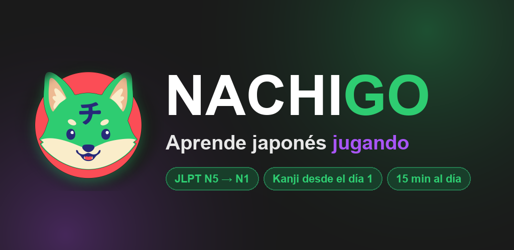
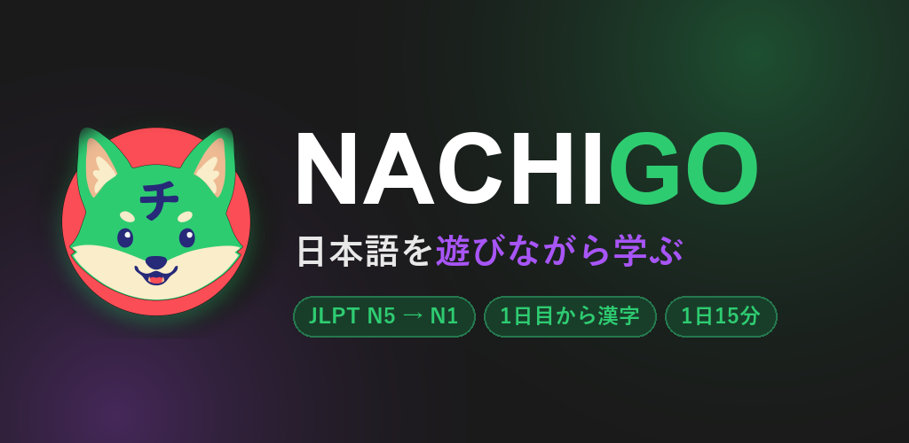
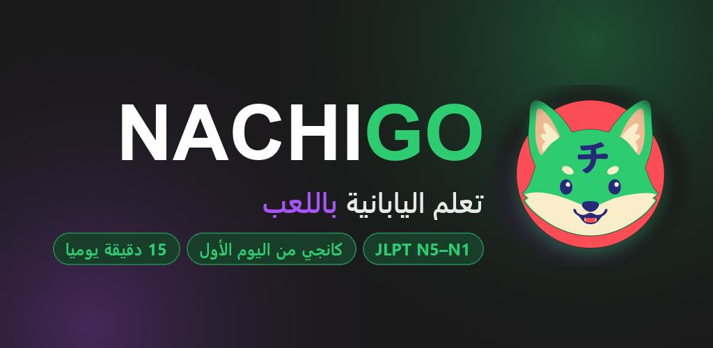
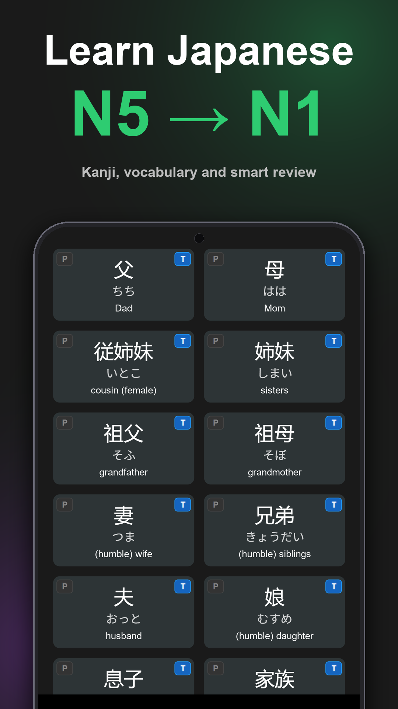
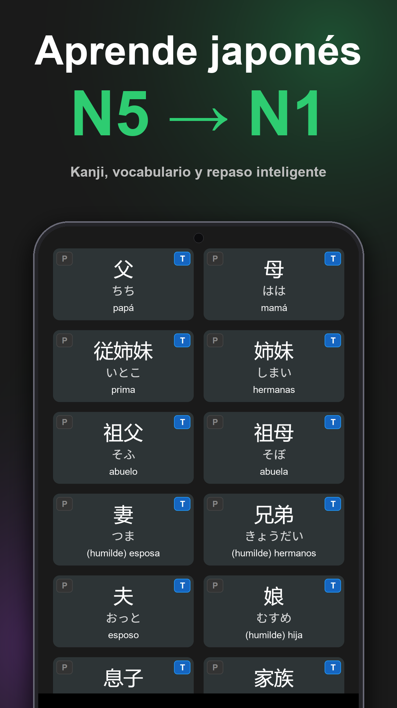
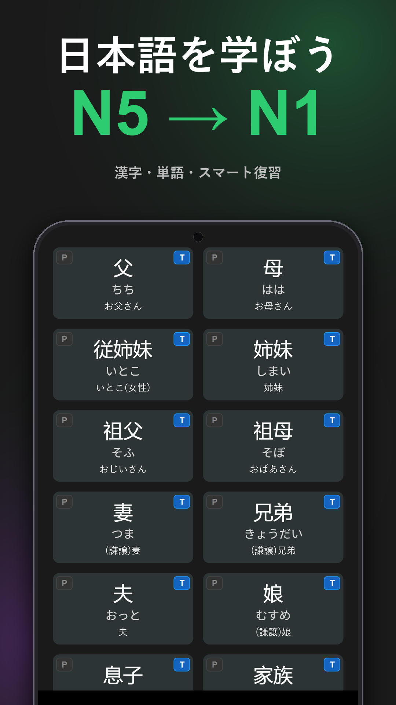
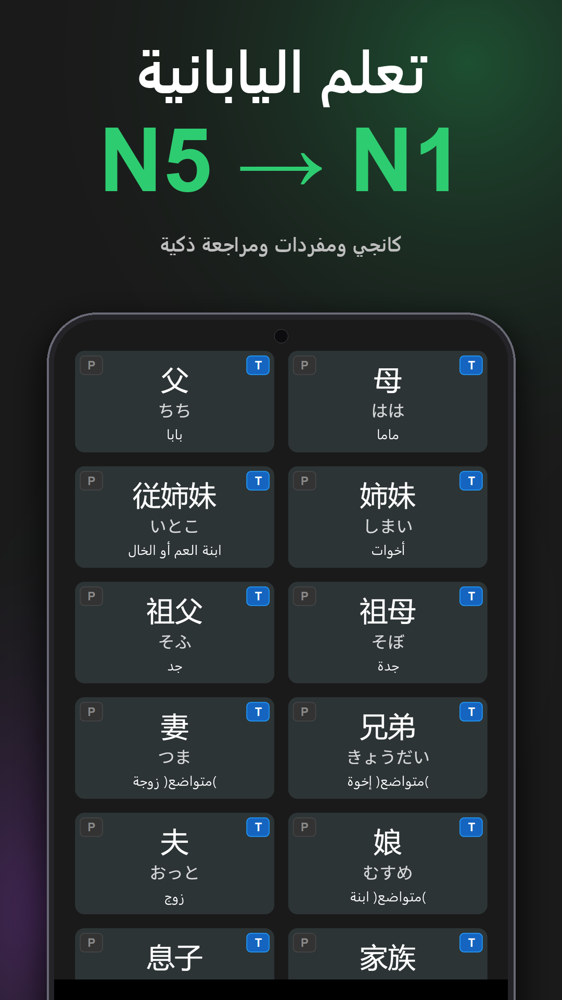

# playstore-python-multilanguage-graphics-generator

Generates localized Google Play store graphics (feature graphic and 8 screenshots) in 17 locales (16 languages) from JSON files, with RTL support (Arabic, Urdu) and per-language fonts. Python + Pillow.

Built to produce the store listing graphics of [Nachigo](https://nachigo.com), a Japanese learning app.






 
 
 


## What it does

- Reads the texts of each locale from a JSON file in `data/`.
- Draws backgrounds, text, cards and a phone mockup with Pillow.
- Shapes Arabic and Urdu text (`arabic-reshaper` + `python-bidi`) and mirrors the layout for right-to-left languages.
- Picks a font per language and shrinks the text until it fits its box.
- Writes one PNG per locale and per graphic.

## Project structure

```
assets/     source images (mascot and app screenshots)
data/       one JSON per graphic, with the texts of every locale
scripts/    one script per graphic, plus the sorting script
examples/   a few rendered results
output/     generated images (ignored by git)
```

| Script | Output | Size |
|---|---|---|
| `banner_img.py` | feature graphic | 1024x500 |
| `store_img_01.py` ... `store_img_08.py` | store screenshots | 1080x1920 |
| `ordenar_por_idioma.py` | copies the images into one folder per locale | |

Each script reads the JSON with the same name from `data/`.

## Install

```bash
pip install -r requirements.txt
```

## Run

From the root of the repo:

```bash
python scripts/banner_img.py
python scripts/store_img_01.py
```

`store_img_02.py` also accepts the locales to generate:

```bash
python scripts/store_img_02.py en-US ja-JP
```

Images are written to `output/<script name>/`. To group them by locale:

```bash
python scripts/ordenar_por_idioma.py
```

This creates `output/por_idioma/<locale>/`.

## Fonts

The scripts load system fonts from `C:/Windows/Fonts/` (Arial, Yu Gothic, Malgun Gothic, Microsoft YaHei, Nirmala UI, Segoe UI), so they run as they are on Windows. These fonts are not included in the repo because of their license. On another system, edit the font paths at the top of each script, or set a `font` key in a locale's JSON entry to override them. The `examples/` folder shows the rendered result.

## Add a language

1. Add an entry with the locale code to each JSON file in `data/`, copying an existing one.
2. If the language needs a special font, add it to the `FONTS` dictionary (or `FONT_BY_LANG` in `banner_img.py`).
3. If it is right-to-left, add its code to `RTL_LANGS`.

## Locales

17 locales, 16 languages (Google Play lists `es-419` and `es-ES` separately):

en-US, es-419, es-ES, de-DE, fr-FR, it-IT, pt-BR, nl-NL, ru-RU, tr-TR, ar, hi-IN, bn-BD, ur, ja-JP, ko-KR, zh-CN